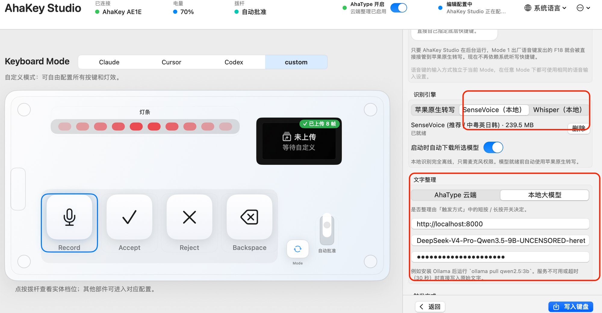

# ⌨️ AhaKey Desktop

**The official cross-platform desktop suite for the AhaKey-X1 — the Vibecoding Keyboard.**

[**English**](README.md) &nbsp;·&nbsp; [**简体中文**](docs/zh/README.md)

[**Documentation**](#documentation) &nbsp;·&nbsp; [**SDK**](sdks/README.md) &nbsp;·&nbsp; [**⭐ Star History**](#star-history) &nbsp;·&nbsp; [**🤝 Contributing**](#contributing)

 

<!-- Release & CI -->

 

<!-- Platforms & Tech -->

## 
Overview

AhaKey Desktop is the companion suite for the **AhaKey-X1 (Vibecoding Keyboard)**, with keyboard configuration, lever-gated AI approval, an on-device voice agent on macOS, and **offline local speech-to-text (SenseVoice / Whisper) + local LLM text cleanup**.

  

### Local Speech-to-Text & Local LLM Cleanup (AhaKey Studio Local)

Both desktop clients (`ahakeyconfig-mac` on macOS and `ahakey-studio-tauri` on Windows/macOS/Linux) include built-in offline speech recognition powered by **sherpa-onnx 1.13.7** and local LLM text cleanup via any OpenAI-compatible `/v1/chat/completions` endpoint (e.g., Ollama, oMLX, LM Studio, vLLM):

- **Offline Speech Engines** ([`LocalRecognizer.swift`](ahakeyconfig-mac/Sources/Utilities/LocalSpeech/LocalRecognizer.swift), [`LocalSpeechEngine.swift`](ahakeyconfig-mac/Sources/Utilities/LocalSpeech/LocalSpeechEngine.swift), [`crates/speech`](ahakey-studio-tauri/crates/speech)):
  - **SenseVoice Small (int8, ~240 MB, default)**: Multilingual offline recognition (Mandarin, Cantonese, English, Japanese, Korean) with ~0.18s CPU decode latency and 1s rolling live preview.
  - **Whisper (`tiny`, `base`, `small`, `large-v3-turbo`, int8)**: ~99-language offline recognition.
  - **Apple Speech (macOS fallback)**: Remains available alongside local models; local models require **only Microphone permission** (no Siri or system Dictation required).
- **Automatic Model Management** ([`LocalModelStore.swift`](ahakeyconfig-mac/Sources/Utilities/LocalSpeech/LocalModelStore.swift), [`model.rs`](ahakey-studio-tauri/crates/speech/src/model.rs)):
  - Background auto-download on launch (opt-out toggle in settings), pinned HuggingFace commit revisions, exact byte-size & streaming SHA-256 verification, atomic staging, and crash recovery.
- **Silence-Aware Utterance Segmentation** ([`LocalRecognizer.segmentRanges`](ahakeyconfig-mac/Sources/Utilities/LocalSpeech/LocalRecognizer.swift)):
  - Splits long recordings at natural speech pauses (≥600ms of silence after ≥3.5s of active speech) and caps segments at 20s with automatic CJK/ASCII punctuation joining.
- **Local LLM Text Cleanup** ([`LocalLLMTextCleaner.swift`](ahakeyconfig-mac/Sources/Utilities/LocalLLMTextCleaner.swift), [`AhaTypeTextOptimizer.swift`](ahakeyconfig-mac/Sources/Utilities/AhaTypeTextOptimizer.swift), [`cleanup.rs`](ahakey-studio-tauri/src-tauri/src/cleanup.rs)):
  - Configurable local OpenAI-compatible base URL, model name, and optional API key as a local alternative to AhaType Cloud.
  - Passes `chat_template_kwargs: {"enable_thinking": false}` and strips `<think>...</think>` blocks so reasoning models (e.g., Qwen3 / DeepSeek) clean text in <1s, with automatic raw-transcript fallback on timeout (30s) or error.
- **Voice Status HUD Attribution** ([`VoiceStatusHUDController.swift`](ahakeyconfig-mac/Sources/Utilities/VoiceStatusHUDController.swift), [`NativeSpeechTranscriptionService.swift`](ahakeyconfig-mac/Sources/Utilities/NativeSpeechTranscriptionService.swift)):
  - Displays the active engine in the floating HUD (`SenseVoice 录音中`, `SenseVoice 识别中`, `由 SenseVoice 生成`).

## 
Documentation

| Resource | What you'll find |
|---|---|
| [Project overview](docs/overview.md) | Features, clients, macOS highlights, build commands, and repository layout |
| [Installation](docs/installation.md) · [Downloads](https://github.com/AhakeyAI/desktop/releases) | Build instructions and published installers |
| [SDK overview](sdks/README.md) · [TypeScript guide](sdks/typescript/README.md) | Plugin development, API reference, and runnable examples |
| [Architecture](docs/architecture.md) · [BLE protocol](docs/ble-protocol.md) | System design and keyboard communication |
| [Contributing](CONTRIBUTING.md) | Bug reports, pull requests, and validation |

## 
⭐ Star History

If AhaKey helps your workflow, give the project a [star on GitHub](https://github.com/AhakeyAI/desktop)! Follow our community's growth in the chart below.

  

  <a href="https://www.star-history.com/#AhakeyAI/desktop&amp;Date">
    <picture>
      <source media="(prefers-color-scheme: dark)" srcset="https://api.star-history.com/svg?repos=AhakeyAI/desktop&amp;type=Date&amp;theme=dark">
      <source media="(prefers-color-scheme: light)" srcset="https://api.star-history.com/svg?repos=AhakeyAI/desktop&amp;type=Date">
      
    </picture>
  </a>

## 
🤝 Contributing

Help improve AhaKey through bug reports, feature ideas, documentation, translations, or code. Read the [Contributing Guide](CONTRIBUTING.md) to get started, and share feedback through [GitHub Issues](https://github.com/AhakeyAI/desktop/issues). Thanks to everyone who has contributed! 🙏

  

