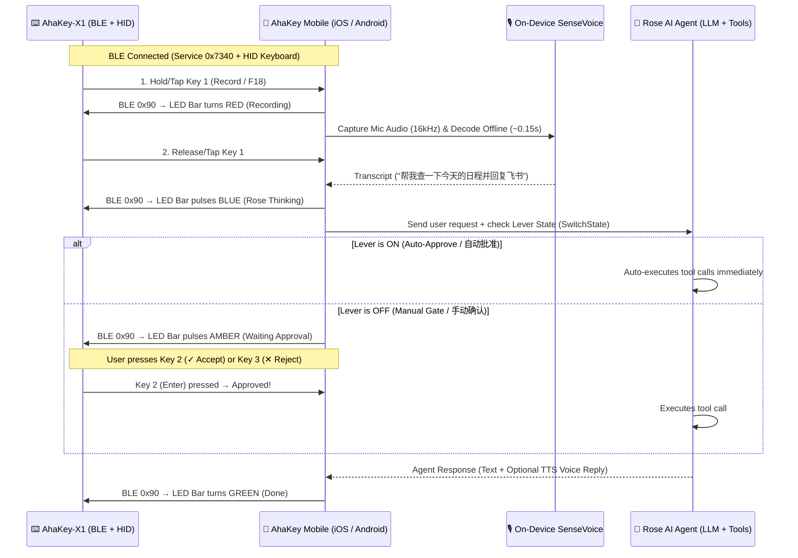

# AhaKey Studio Mobile (iOS & Android) — Roadmap & TODO List
# AhaKey Studio 移动端（iOS 与 Android）—— 架构方案与待办清单

> **Target Platforms / 目标平台**: iOS (iPhone / iPad) & Android  
> **Primary Use Case / 核心场景**: Use AhaKey-X1 over Bluetooth (BLE + HID) as a physical push-to-talk voice controller and hardware lever/button approval console for the AI Agent ("Rose" / Voice Agent).  
> 通过蓝牙（BLE + HID）连接 AhaKey-X1 键盘与手机，将实体按键与物理拨杆作为手机端 AI Agent（Rose / 语音助手）的「按住说话控制器」与「工具调用硬件审批台」。

---

## 1. System Architecture / 系统架构

### Hardware-to-Agent Control Mapping / 实体按键与拨杆映射

| Hardware Control (硬件控件) | BLE / HID Signal (信号) | Mobile AI Agent Action (手机端 Agent 动作) |
| :--- | :--- | :--- |
| **Key 1 (`Record`)** | HID `F18` (`0x6D`) | Short-press toggle or hold-to-talk (500ms threshold) to record voice for Rose |
| **Key 2 (`Accept` / `✓`)** | HID `Enter` | Approve Rose's pending tool call / confirm action |
| **Key 3 (`Reject` / `✕`)** | HID `Esc` | Reject pending tool call / cancel current generation |
| **Key 4 (`Backspace` / `⌫`)** | HID `Backspace` | Undo last turn / clear current voice draft |
| **Physical Lever (`物理拨杆`)** | BLE Notify `0x7344` (`SwitchState`) | **ON (1)** = Auto-Approve tool calls; **OFF (0)** = Manual confirmation via Key 2/3 *(Fail-safe: defaults to Manual if BLE disconnects)* |
| **LED Light Bar (`LED 灯条`)** | BLE Write `0x7343` (`cmdUpdateState = 0x90`) | **Red** = Recording, **Blue** = Thinking, **Amber** = Waiting Approval, **Green** = Completed |

---

## 2. Recommended Tech Stack / 推荐技术栈

| Layer (层级) | Technology (技术选型) | Code Reuse & Rationale (复用与原因) |
| :--- | :--- | :--- |
| **Cross-Platform App** | **Tauri v2 Mobile (`tauri ios` / `tauri android`)** | Reuses React/TS frontend (`ahakey-studio-tauri/src`) and Rust core (`src-tauri`) |
| **BLE GATT (`0x7340`)** | Rust BLE crate (`tauri-plugin-blec` / `btleplug`) or Swift `CoreBluetooth` bridge | Implements the 5-byte frame protocol (`AA BB [cmd] [data] CC DD`) from [`docs/ble-protocol.md`](ble-protocol.md) |
| **HID Key Capture** | iOS `UIKeyCommand` / `onPressesBegan` + Android `onKeyDown` + WebView key events | Captures physical Key 1–4 press/release durations for short-press vs. long-press |
| **On-Device Offline STT** | **`sherpa-onnx 1.13.7` (`SenseVoice int8` / `Whisper`)** | Uses prebuilt `ios-arm64` and `android-arm64-v8a` runtimes; reuses `crates/speech` |
| **Text Cleanup & Agent** | OpenAI-compatible `/v1/chat/completions` + Tool Calling | Connects to Rose AI Agent, cloud LLM, or local LAN/Tailscale LLM (e.g. `oMLX` / `Ollama`) |

---

## 3. Implementation TODO List / 分阶段开发待办清单

### Phase 1: Mobile Scaffold & BLE Hardware Bridge (移动端脚手架与蓝牙通信)
- [ ] **1.1 Initialize Mobile Targets**:
  - Run `cargo tauri ios init` and `cargo tauri android init` inside `ahakey-studio-tauri/`.
  - Configure iOS `Info.plist` (`NSBluetoothAlwaysUsageDescription`, `NSMicrophoneUsageDescription`, `UIBackgroundModes: bluetooth-central, audio`) and Android `AndroidManifest.xml` (`BLUETOOTH_SCAN`, `BLUETOOTH_CONNECT`, `RECORD_AUDIO`).
- [ ] **1.2 Implement BLE Protocol Codec (`crates/ble` or mobile plugin)**:
  - Port frame builder/parser (`AA BB [cmd:1] [data:N] CC DD`) from `ahakeyconfig-mac/Sources/BLE/AhaKeyProtocol.swift`.
  - Connect to Service `0x7340` (`0x7343` COMMAND write, `0x7341` DATA write, `0x7344` NOTIFY subscribe) and Battery Service `0x180F` (`0x2A19`).
  - Implement device status query (`AA BB 00 CC DD`) and real-time lever state (`SwitchState`) notifications.
  - Implement LED state push (`AA BB 90 [state] CC DD`) so mobile agent states reflect on the keyboard light bar.
- [ ] **1.3 Implement Hardware Key Press State Machine**:
  - Capture `F18` (Key 1), `Enter` (Key 2), `Escape` (Key 3), and `Backspace` (Key 4) keyDown / keyUp events on iOS and Android.
  - Implement the 500ms threshold detector:
    - Short press (<500ms): toggle recording start / stop.
    - Long press (≥500ms): hold to record, release to send.

### Phase 2: On-Phone Offline Speech Recognition (手机端离线语音识别)
- [ ] **2.1 Bundle `sherpa-onnx` Mobile Runtimes**:
  - Extend `ahakey-studio-tauri/crates/speech/scripts/prepare-runtime.sh` to download and SHA-256 verify `sherpa-onnx v1.13.7` for `ios-arm64` (`xcframework` / static lib) and `android-arm64-v8a` (`libsherpa-onnx-c-api.so` + `libonnxruntime.so`).
- [ ] **2.2 Mobile Audio Capture & Resampling**:
  - Verify 16 kHz mono Float32 microphone capture on iOS (`AVAudioSession` with `.playAndRecord` + `.allowBluetooth` for AirPods + AhaKey simultaneous connection) and Android.
- [ ] **2.3 Model Download & Silence-Aware Segmentation**:
  - Reuse `ModelStore` (SHA-256 verified background download of `sensevoice-2024-07-17` int8, ~240 MB) in the app's mobile application-support directory.
  - Enable silence-aware utterance segmentation (≥600ms pause splitting + 20s window cap) and optional non-thinking LLM text cleanup (`chat_template_kwargs: {"enable_thinking": false}`).

### Phase 3: Rose AI Agent Console & Hardware Lever Gate (Rose AI 助手与拨杆硬件审批)
- [ ] **3.1 Agent Session & Tool-Calling Orchestrator**:
  - Port or connect the `VoiceAgent` supervisor/tool-calling loop (`LLMClient`, session memory, MCP/tool registry) to the mobile client.
  - Support configurable Agent endpoints (Rose AI Agent API, local Mac `oMLX`/`Ollama` over LAN/Tailscale, or OpenAI/Anthropic compatible endpoints).
- [ ] **3.2 Hardware-Gated Tool Approval Flow (Fail-Safe)**:
  - Before executing any sensitive agent tool call, read the cached BLE `SwitchState` (lever position):
    - **Lever = Auto (`1`) & BLE Connected**: Auto-approve and execute tool call; flash green on LED bar.
    - **Lever = Manual (`0`) or BLE Disconnected**: Pause execution, set LED bar to Amber, and show the **Pending Approval Card** in the mobile UI.
  - Bind physical **Key 2 (`Accept`)** to approve and run the tool call, and **Key 3 (`Reject`)** to cancel/reject it.
- [ ] **3.3 Voice Output / Hands-Free Mode (Optional)**:
  - Add optional TTS playback for Rose's replies and iOS Live Activity / Android Foreground Service so you can interact with Rose via the AhaKey without touching the phone screen.

### Phase 4: Optional System-Wide Voice Input (可选：跨应用全局语音输入)
- [ ] **4.1 Android `AccessibilityService` / `InputMethodService`**:
  - Allow global background `F18` interception and direct text injection into third-party apps (WeChat, Slack, browser) on Android.
- [ ] **4.2 iOS Custom Keyboard Extension (`UIInputViewController`)**:
  - Provide an optional "AhaKey Voice Keyboard" extension on iOS for dictating into other apps via shared App Group container.
