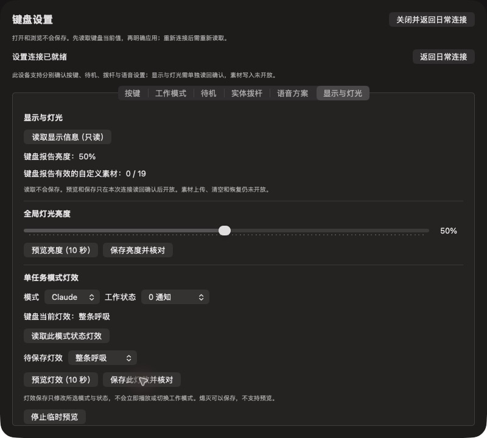

# WS3新固件阶段验收：配对恢复、显示单项与取消

2026-10-19，客户端0.2.3/arm64/source ed64166，App和Agent均为Applications中的同源二进制。固件memory-fix HEX身份与刷写记录见同目录WS3_NEW_FIRMWARE.md；固件团队最终REGATE仍不由本记录替代。

## 实际通过

| 项目 | 结果与边界 |
| --- | --- |
| 系统配对恢复 | App关闭时仍失败；执行当前固件Forget hosts并重新配对后用户报告恢复。没有改刷固件或擦除整份数据。该操作重建绑定/白名单/密钥相关状态，不能单独定位具体LTK故障 |
| 系统HID | IORegistry出现AhaKey505C、Bluetooth Low Energy、UsagePage1/Usage6键盘节点 |
| 配置连接 | ed64166启动后自动连上505C、状态/服务可用；不是仅依据“断开连接”按钮判断 |
| WS3只读 | 0x88亮度、19项basic/integrity完整同代快照通过；原亮度35%，有效自定义素材0/19。只证明元数据，不验证实际图像字节 |
| 草稿保留 | 亮度草稿50%时读回仍35%，读取不自动保存 |
| 亮度临时预览 | 用户要求重播后确认看到预览，约10秒自动恢复；保存值读回仍35% |
| 亮度单项保存 | 35→50，0x8E完成后读回50；无全量0x04 |
| 灯效单项保存 | Claude/通知原中心脉冲(effect10)→整条呼吸(effect5)，读回一致；没有主动切模式 |
| OFF限制 | 选择熄灭时灯效预览按钮禁用，保存按钮仍可用；未为了测试额外保存OFF |
| 重启与重连 | 用户正常关机开机，自动重连；旧能力/快照撤回、草稿保留；重新查询确认亮度50、Claude/通知effect5保持 |
| 恢复原值 | 已恢复35%与effect10/中心脉冲，并分别保存后读回一致；本机restore_required已清除 |
| 实际只读取消 | 在39项0x88读取期间点击全局取消，连接/快照失效，预览/保存禁用，显示需重连；重连后重新读取，未复用旧快照 |
| Voice保留 | onboarding3、四个F18绑定已确认；保留App接管方案。未发96/Voice写入，未测试或恢复Consumer/F5 |
| App→Agent | 关闭设置交还后台后同源Agent连上新固件，fresh approval_status返回physical0、factory auto verified=true/version1 |
| 连接错误短采样 | 配对恢复后的45秒及后续90秒片段均无4803、无密集Studio connect记录；不能当作长时零故障承诺 |
| 短时CPU | 后台连接态30秒7点：GUI CPU用时+0.26秒、Agent+0.07秒；瞬时GUI0–10.2%、Agent0–0.7%。GUI瞬时峰值未表现为持续高占用；未覆盖长时/GIF/所有显示场景 |

测试期间界面（截图中的50%/呼吸是受控测试值，现已恢复原值）：

## 尚未覆盖

- 新固件手动档已通过：用户切手动后fresh physical=1、verified=false，界面手动；Cursor beforeShellExecution=ask，Claude PreToolUse无allow/PermissionRequest=ask，Codex PermissionRequest无allow且on-request，Kimi配置false。2026-10-20亮屏重拨后fresh0/verified=true，Cursor/Claude/Codex实际Hook均allow、Codex never；直接Hook进程不等于运行中CLI缓存重载。
- 2026-10-20已完成16键逐字节、待机/Voice引导/拨杆绑定比对，全部一致；新记录见../connect-talk-hil-2026-10-20/README.md。
- 新设备失败状态的真实15秒取消/错误计数、取消完成后的手动恢复；正常配对后不能靠故意破坏配对来宣称覆盖。5项隔离状态机测试通过，不等于该故障真机已复现转绿。
- 0x89灯效预览和显式stop的独立视觉矩阵、所有模式/状态保存、恢复后再次断电及跨端互操作。
- 资源上传/清空/恢复、CP1呈现/D02、DATA中断/迟到帧/全故障矩阵、长时CPU/灵动岛/电量校准以及最终公证发布。

267项Swift测试、签名与复核事实沿用冻结源码验证。没有因纯验收文档重复运行未变化的测试。PR#141继续目标connect&talk，不能把本检查点写成完整WS3或最终用户版验收。
