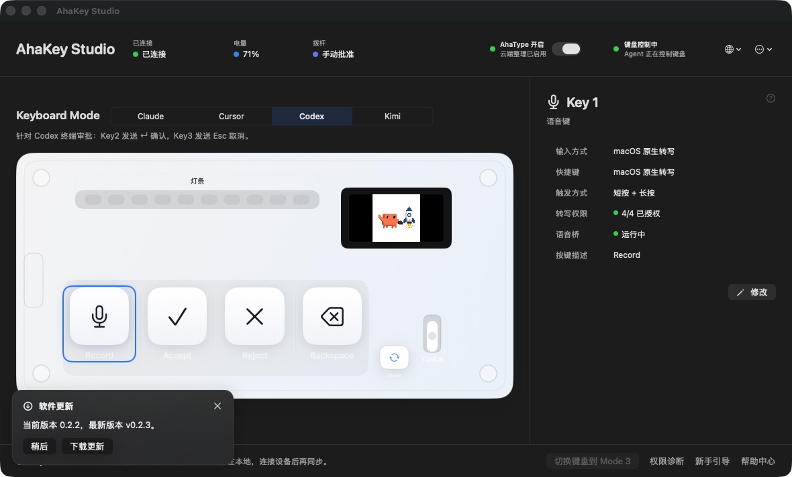
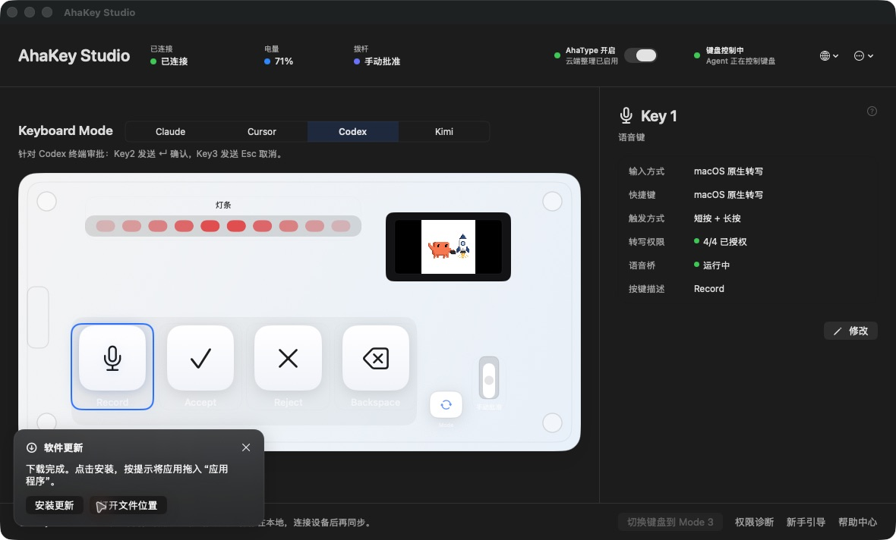

# 语言、软件更新与AhaType登录入口（2026-10-21）

基线connect&talk/4ca05c0；分支codex/connect-talk-client-update-login。实现eafa0c7、启动静默验证补充e6422c4。最终签名候选0.2.3 arm64/e6422c4已安装，Developer ID deep/strict通过。本批不含键盘协议/固件/键位/Voice写入。

## 变更与边界

- 语言按钮只有地球图标及菜单箭头；下拉保留跟随系统、简体中文、English，保留无障碍标签，不变更用户语言偏好。
- 每次启动异步检查一次，移除24小时跳过；手动检查立即显示左下角卡片。新版本询问后才下载，下载展示已收字节/总量/速度，未知总量用不确定进度。完成SHA256校验后显示安装更新、打开文件位置；安装打开DMG，由用户拖入Applications，不自动覆盖应用。
- 旧实现API等待20秒，403/429后再对同一API直连最多20秒，仍依赖匿名API配额。现在请求各6秒有界，403/429在本进程记忆；API不可用时读取公开Release页及expanded_assets，严格取本仓库版本化DMG和同资源SHA256，不绕过摘要或TLS。真实发布页fallback已解析到v0.2.3和官方摘要。用户先前403的响应头未留存，不能断言具体是配额、代理还是其他原因；模拟403回归覆盖已通过。
- AhaType缺令牌、本地过期、HTTP401、HTTP200业务Token失效均清失效会话、保留启用开关及原始转写，并回登录入口。启用状态下启动静默检查服务端；网络/配额403不当作退出依据。旧Token请求不能清空或覆盖新登录。账号和转写共用认证失效分类，后台刷新也能撤回错误登录态。

## 验证

全320项Swift测试通过；随后新增1项过期/旧回包保护，针对性9项通过（最终321项由CI复核）。覆盖403公开页后备与API限流记忆、静默无更新、不擅自下载、URLSession实际下载/正确摘要落盘/错误摘要拒绝交付、delegate字节总量和速度、HTTP401非JSON/业务失效/配额403/缺Token/静默账号失效/过期与旧请求保护。双轴及窄复核通过，最终文件校验/去重/落盘均在utility任务，主线程仅更新状态。

原生UI：为触发真实新版提示，临时仅把同源eafa0c7 QA包版本标为0.2.2（不是安装旧代码），启动后自动发现公开v0.2.3，在左下角出现下载询问。点击下载出现下载进度及字节/速度位置，约数秒后通过校验并显示安装/文件位置两个按钮；安装按钮成功打开AhaKey Studio Installer和Applications入口，未拖拽覆盖。文件位置按钮在Finder选中AhaKey-Studio-macOS-v0.2.3.dmg（11.8MB）。安装映像已卸载，最终恢复正常0.2.3候选，测试包不是公开0.2.3旧Release。

地球下拉实际显示跟随系统/中文/English，截图中没有系统语言文字。真实账号页刷新识别失效后，直接显示手机号、密码、登录、注册以及“登录已失效，请重新登录。”；未代用户提交登录或支付。敏感账号字段未归档为公开截图；测试使用独立配置和测试Token，不往生产账号注入假凭证。

截图：

本批不是正式公证发布；安装了签名测试候选。断网、异常中断与多版本正式分发仍需发布环境继续覆盖，不宣称所有GitHub故障均已消除。
