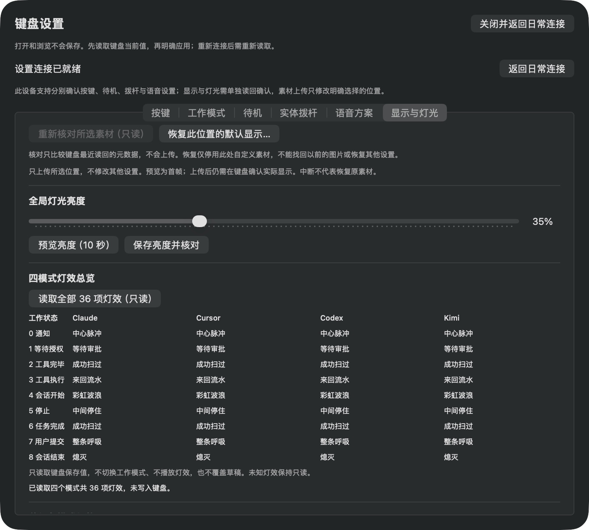

# D03 四模式灯效只读总览真机验收

基线connect&talk/39d4d70，签名候选0.2.3 arm64/2795aa5已安装，Developer ID deep/strict通过。全365项Swift测试（新增7项）与Standards/Spec复核通过。固件仍CP2/HEX ffb9208f，无刷写。

## 已完成

- 初始Agent日常连接/实体自动档，进入配置后完整19项读回35%/有效1项/Codex默认1帧。新总览在读取前无表，不导入草稿。
- 完整读取成功后实际AX包含36个唯一模式/状态标签，四模式列、九状态行，包含四个OFF；截图人工检查无裁切/重叠。成功提示明确未写入。所选单项可用最近读回值，待保存仍“请选择”，没有自动覆盖草稿。
- 再次点击总览并在读取中明确取消，旧表和成功提示撤回、写入口禁用；配置正常断开后自动重连。重新完整读19项成功，无需键盘关开；本轮未发起素材事务。
- 选择Claude的会话结束状态，仅单项读回OFF=0；待保存显示熄灭，预览入口禁用。再次读取全部36项成功，OFF草稿仍保留。切回通知后草稿回请选择；没有保存或预览。
- 原始AX与短CPU样本仅本机私有。未知effect255、拒绝/错帧与跨代次等路径由新增自动回归覆盖；未伪造键盘未知值。

## 观察到的连接故障

首轮中曾发生CoreBluetooth连接超时（23:34:06），4秒后自动重连；表/能力撤回，没有半张成功表或错误成功提示。该事件未归因于读取实现，不声称修复无线掉线；既有旧候选日志也有独立超时记录。后续完整读取和受控取消恢复分别通过，完整无线故障矩阵仍待。

## 收尾与未覆盖

本批只使用0x88读取及既有只读能力/状态查询；没有保存灯效、亮度或素材，不改键位/Voice，不切键盘工作模式。亮度35%、有效自定义1/19保持。当前单项草稿已回“请选择”。已交还Agent：fresh connected=true、physical/effective=0、autoVerified=true；首页58%/自动批准，语音桥运行中。静态表10秒CPU+0.02秒，仅短样本。

D03全模式/全状态保存与断电保持、OFF保存、停止预览实际效果和故障全矩阵仍待；不能把只读总览当保存验收完成。完整CP3/旧固件回归继续按WBS。
