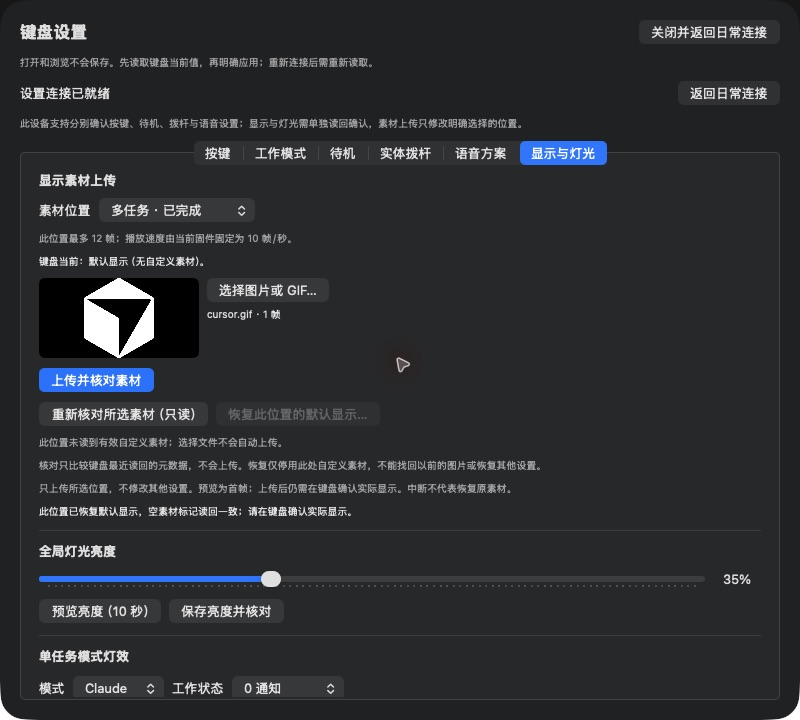

# D05 CP2 素材核对与单位置恢复（2026-10-21）

基线connect&talk/aa6e844。实现92fd4fa，已安装同源0.2.3 arm64候选，Developer ID deep/strict通过。固件仍接受的CP2/ffb9208f，无刷写。全344测试通过，含10项协议/语义及2项实际Manager操作所有权回归；双轴复核及修正后窄复核通过。

## 已完成

- 原生设置页完整读回35%/有效1项，Codex默认仍1帧。重新选择原JPEG，只读按钮重新查0x88后报告entry/frames/payload长度/CRC元数据一致；没有重新上传或恢复该用户图片。
- 选择原EMPTY的位置18（多任务已完成），界面明确“默认显示（无自定义素材）”且恢复按钮禁用，避免无效保存。
- 向该空位置临时上传内置cursor.gif一帧（598块），Commit后元数据一致，有效资源变2/19。恢复按钮启用，弹窗仅明确该位置的默认恢复范围。
- 首次取消确认，随后只读核验仍与cursor文件元数据一致，有效仍2/19；这是**取消确认**的测试，不是正在执行8D时取消的真机证明。
- 再明确确认后发送单位置8D；生产事务先重新核对baseline、精确ACK、后读false/EMPTY/frames0/bytes0/CRC0，界面成功且恢复按钮再次禁用。有效回到1/19，亮度35%。不是仅凭ACK判断成功。
- 回Codex默认、重新选择原JPEG并再次只读查询，元数据仍一致。原图及截图仅本机私有；公开截图只含内置测试图标。

## 等待/未覆盖

已请求用户正常重启，随后核对EMPTY标记断电保持、Codex原图元数据与实际显示。等待期间已关闭设置，恢复日常Agent连接；fresh确认physical/effective=1、verified=false且connected=true。收到反馈后需重新进入配置并读取。当前尚未标重启保持通过。

活动资源的实际默认回退画面、19位置全矩阵、真正传输中取消/断连/拒绝故障和CP3/整库/整机恢复仍未做，不扩大本批结论。0x8D只是持久化元数据解除引用，原Flash字节可能保留，不是安全擦除或历史图片备份/找回。测试位置18最终回原EMPTY标记；未向Codex位置8、键位、Voice或亮度发送写入。

## 代码复核修正

复核指出新增reset清flags后，旧显示读/预览/保存defer可能释放新连接的busy。已把六个共享入口统一到UUID+generation ticket；实际Manager隔离测试覆盖powerOff/reset→新操作→旧任务退出，以及同代次旧ticket重复退出，确保旧调用不能解锁新操作。只读、恢复失败及取消不冒充回滚，连接变化撤元数据比较依据。

只读负例也已实际验证：在Codex位置选择内置cursor文件后点击核对，界面报告元数据不同、未更改键盘；再选择原JPEG，比较恢复一致。仅本地文件选择与0x88查询，无该用户位置的上传/恢复写入。
