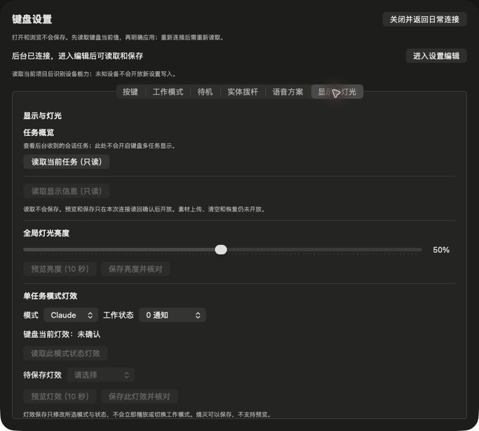

# D02-B1任务观测候选安装与接线验收

2026-10-21。源d9840345cb6838b6048595a68186e8fc2d399060，0.2.3/arm64 Release，Developer ID deep/strict通过。本机/Applications/AhaKey Studio.app已安装此源，旧364abbb包已私有备份；GUI与Agent同源。固件仍为已刷CP2 memory-fix，不刷写、不改键位/Voice/亮度/素材或SINGLE/MULTI模式。

## 实际结果

- 新后台自动连接，实时physical1/manual，界面一致。显示与灯光页只读任务概览按钮可用，其他需App配置连接的保存/预览仍禁用。未为读取任务切换蓝牙归属。
- 候选后台已接到两个有真实标识的Codex会话，界面点读取展示两个不同hash引用和进行中状态。此结果只证明本机当前会话/Hook接线，不替代所有CLI版本矩阵；完整标识未写入新增状态文件或公开证据。
- 用已安装agent的Hook进程注入明确合成session/conversation：Claude UserPromptSubmit、Cursor postToolUse进入其余两个空槽；再发送Kimi UserPromptSubmit触发容量不足。已有两个活跃任务未被挤走，保持四槽并返回未纳入事件警示。界面读取实际显示四行与橙色容量说明。Kimi仅测试此共享状态事件，不代表Kimi审批/独立CLI全流程验收。
- 合成SessionEnd事件清除两个已进入槽位的测试会话；未进入槽位的Kimi结束事件不制造新任务。仅剩原Codex会话；带会话引用的截图/回包保留本机私有目录，公开截图为未读取任务前的UI，避免发布会话引用。
- 经原生界面停止Agent，连接/档位立即撤回、进程退出，Codex仍on-request。重新启动后自动连接，首次presentation_tasks读回0任务、容量计数0；无测试会话重放。之后新Hook可重新填充新事实，不回放旧缓存。
- 安装二进制实际Permission Hook回归：先fresh确认实体manual；Codex无allow、Cursor beforeShellExecution返回ask、Claude PreToolUse无allow。均只运行Hook子进程，不执行工具命令，合成会话随后清除。Kimi及自动档完整矩阵本批未重测。
- 测试后恢复同源Agent日常连接，实体手动档、详细日志关闭，诊断面板关闭。没有新配置写入，也没有0x98/99发送或MULTI显示生效的声明。

## 隔离与复核

新增任务事实7项、真实临时socket2项、实际Codex handler1项通过。复核发现慢概览跨真实心跳断连/重连可能恢复旧UI；新增第11项回归先复现1失败，连接变化撤销发布代次后全288测试通过，Standards/Spec两轴窄复核通过。

实际无线掉线/重连的本版专属任务清理矩阵、Quiet/Sleep、前台事实、App直连任务路径以及生产0x98/99路由仍未验收；本次只完成会话观测和只读界面。前一版关机/重连证据不能直接替代本版任务全矩阵。短CPU记录另附，不替代长时性能。

短CPU采样约30.45秒：GUI累计+0.49秒、Agent+0.09秒，采样瞬时GUI最高0.9%、Agent0.7%，未见持续高占用；包含关闭诊断面板，非长时性能结论。原始采样仅本机私有备份。
