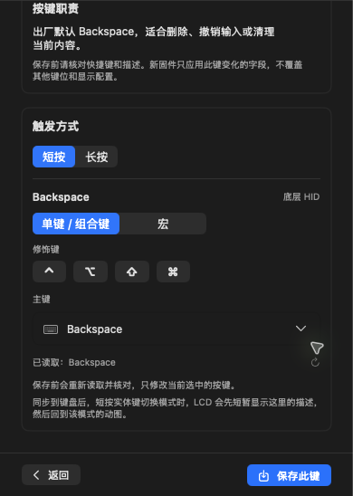

# Studio编辑态原生控制恢复

## 故障与证据

此前普通首页可读；进入按键编辑后，SkyComputerUseService抛EXC_BREAKPOINT/SIGTRAP，栈顶_assertionFailure/Array.remove(at:)。屏幕编辑同样复现；按键改到宏或长按仍复现，完整快照disableDiffing和截图入口也失败。退出编辑后原生读取恢复，说明不是单纯重启Codex或重新授权能消除的触发条件。

本机至少5份ips前几帧偏移一致。服务版本26.1015.1001540，签名验证通过。原始崩溃文件保留在本机私有local-backups/cua-service-diagnosis-20261022，没有上传原始日志、用户图片或会话数据。

用户明确授权AppleScript仅恢复/检查Studio与本轮验收。System Events能读取相同窗口；其树中默认GroupBox标题为无普通文本子节点的AXHeading。单纯GroupBoxStyle调整仍保留该结构、仍失败。因此最终在Studio Inspector内使用显式Text标题的StudioInspectorSection，保留子控件和contain分组，不修改控制服务本体或权限。

该结构是本次已验证的兼容性触发点；闭源服务内部的准确越界代码行未取得，不声称已修复所有应用中的同类服务缺陷。

## 最终构建与对照

最终代码/本机签名候选：d2345a26dce95aea6a3945f8b21a45ed706d5074，0.2.3 arm64，deep/strict通过。

| 原生路径 | 默认GroupBox构建 | 显式标题分组构建 |
| --- | --- | --- |
| 首页、选Key4 | 通过 | 通过 |
| Key4→修改→读控件树 | 崩溃 | 通过，多次读取/进出 |
| 宏编辑 | 崩溃 | 通过，草稿改回普通快捷键，未保存宏 |
| 长按标签 | 崩溃 | 通过，已切回短按 |
| 屏幕→修改 | 崩溃 | 通过，未选择/上传/清除素材 |
| 截图、描述输入、保存按钮 | 编辑态不可继续 | 均可原生操作 |

新分组保留14处Inspector内容、标题和子控件，不隐藏交互元素；两路窄复核通过。不是通过关闭辅助功能或屏幕权限绕过问题。

最小复现/回归入口是CUA真实绑定Studio→点虚拟Key4→右侧修改→getAXState。旧包在该调用及新ips中可直接判红；新包须能读取描述字段、短长按和保存控件。此依赖本机原生服务，不用假UI单元测试声称已覆盖外部服务断言。

## 本次UI与设备验收

1. 用户指定布局为主键下方先“已读取：Backspace”+刷新，再保存前核对和LCD说明；已用原生AX及截图核对。安全截图仅捕获右侧，不含用户素材。
2. 正常编辑草稿时后台连接恢复，配置读取/保存时暂时交接。
3. 仅Codex/Mode3 Key4描述由Backspace临时改TestBack。保存此键后读回一致、未同步变0；新一次连接独立读取字段仍TestBack。
4. 描述恢复Backspace，再保存读回一致。相同值再次保存显示“本次未写入”，不伪装新保存。
5. 再次读回后进入宏/短长按，仅修改本地草稿；已恢复普通Backspace/短按，未同步0。最终退出编辑归还后台。
6. Key1/Voice、其他键、Coffee资源和灯光没有发起修改；未刷固件，未声称本次断电保持或完整16键/旧固件/故障矩阵通过。

私有AX记录位于local-backups/inspector-session-20261022，包括key4-TestBack-saved、key4-TestBack-fresh-read、key4-restored、key4-unchanged和accessible-oled-editor；不要把独立设置页验收当右侧链路证据。

