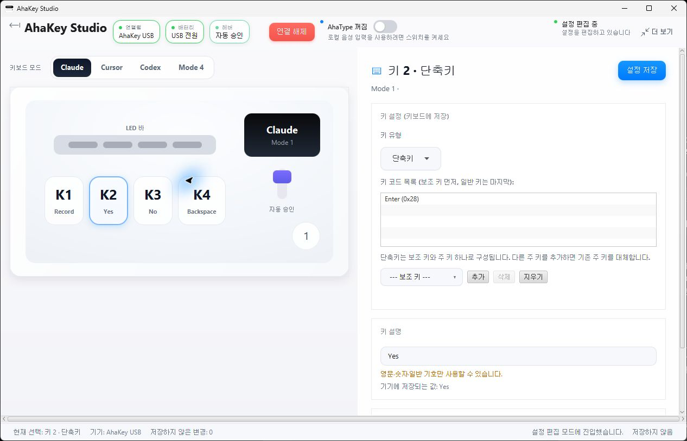

# Korean interface for the Windows Java client

This is a community localization of `ahakeyconfig-win-java`, based on upstream
commit `0ddab17fc8128d4090a5f1963354be666771f6f3`. It is not an official AhaKey release.
The upstream Apache 2.0 license and existing third-party licenses still apply.

## Scope

- Select **한국어** under **More → Language**, then restart the application.
- Korean Windows locales (`ko`, `ko-KR`, `ko_KR`) select Korean on first launch.
  An existing explicit language preference takes precedence.
- Main UI, settings, shortcuts, macros, lighting, OLED, firmware/standby dialogs,
  local voice settings, account controls and locally generated status text are translated.
- Device-facing labels still accept only the characters supported by the firmware.
  HID codes, protocol commands, stored identifiers, permissions and account requests are unchanged.
- This adds a Korean interface, not Korean support to the bundled/local speech model.
  Speech requires a microphone. Server-provided errors and diagnostic logs may retain their original language.

## Build

Requirements: JDK 17, Maven, .NET Framework 4.7.2 reference assemblies and MSBuild
for the BLE bridge; WiX 3.14.1 for the optional EXE installer.

1. Run `mvn -B clean package` in `ahakeyconfig-win-java`.
2. Restore/build `BLE_tcp_bridge/BLE_tcp_driver.csproj` with MSBuild in Release mode.
3. Run `build-korean-windows.ps1 -RuntimeImage <Java17-runtime-with-JavaFX>
   -IconPath <AhaKeyStudio.ico> -JdkHome <JDK17> -WixBin <WiX-bin>`.
   The runtime and icon may come from an existing official installation.

The local build includes the complete Maven JAR and its dependencies, a JavaFX runtime,
and the BLE bridge. It does not include speech models, firmware or WCHISP. The EXE is
not publisher-signed. The official release pipeline is unchanged.

## Upgrade and recovery

Keep the original installer and back up the current application directory and
`~/.ahakey` preferences before upgrading. Do not run two Studio instances at once.
The installer keeps the existing upgrade-family and application-directory safeguards.
To return to the original version, uninstall the community build, reinstall the original
official version, and restore the saved preferences if necessary. Never remove another
application's directories or reset the keyboard to recover an interface-language change.

## Validation

Catalog completeness, format argument parity, locale normalization, preference retention,
and unchanged technical identifiers are covered by automated tests. The source-level
catalog check covers every Chinese literal already passed through `localize`.
Actual Windows UI, installer and connected-device validation results are recorded below
when performed. Microphone, Bluetooth and firmware flashing require separate hardware validation.

### Windows verification (2026-10-28)

- Full baseline run: 403 tests, with two existing timeout errors in
  `FirmwareUpdateServiceTest.uidQueryFailureStillAllowsFlashWithoutChangingFlashCommand`
  and `unknownChipDevelopmentOverrideAllowsClosedLoopTestWithoutPretendingMatched`.
  The localized run had the same two errors (406 tests, zero assertion failures).
- Excluding only those two baseline timeouts: 404 tests passed, followed by complete
  Maven packaging and release-artifact content checks. Korean coverage includes
  whitespace-separated and concatenated Java string literals.
- Korean installer UI, installation, application launch and live USB status were checked
  on Windows. The installed JAR is compared by SHA-256 with the tested Maven JAR.
- No keyboard configuration, firmware, Hook or account changes were required for this
  localization check. Physical microphone recognition and Bluetooth remain untested.
- The local installer revision is **1.5.5**, based on source **1.5.4**. This is a community
  package revision for MSI upgrade ordering, not a new upstream application release.
  Use `-PackageVersion 1.5.5` when reproducing that package.

### Regression boundaries

| Changed state | Writer and consumers | Expected result / evidence |
|---|---|---|
| Language preference | TopBar selection -> LanguageManager -> stable keys and legacy UI text | Korean round-trip retains unrelated preferences; English/Chinese tests preserve prior results. |
| Display-only account status | CloudAccountDialog reads existing manager status | Translate known UI text; API payloads, authentication and unknown server text remain unchanged. Account network flow was not exercised. |
| Bilingual labels | Existing dialog helpers read `usesLocalizedLiterals()` | Korean uses translated literals; nonlocalized languages retain English fallback. |
| Installer language/version | Korean build target -> WiX and launcher | Korean wizard verified; original directory-ownership and upgrade safeguards retained. Official release targets unchanged. |

Korean selection does not bypass existing connection, capability, write-confirmation,
download-consent or firmware checks. Their handlers and protocol identifiers are unchanged.
The confirmation for device writes remains before the write; a localization check does not
establish hardware-write, voice, cloud-account or AI-approval acceptance.
