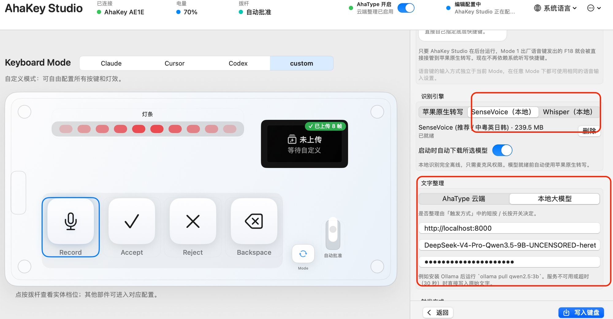

# ⌨️ AhaKey Desktop

**AhaKey-X1（Vibecoding Keyboard）官方跨平台桌面端 · 键盘控制 + 拨杆审批 + 本机语音 Agent**

[**English**](../../README.md) &nbsp;·&nbsp; [**简体中文**](README.md)

[**文档**](#documentation) &nbsp;·&nbsp; [**SDK**](sdk.md) &nbsp;·&nbsp; [**⭐ Star 趋势**](#star-history) &nbsp;·&nbsp; [**🤝 参与贡献**](#contributing)

 

<!-- Release & CI -->

 

<!-- Platforms & Tech -->

## 
概述

AhaKey Desktop 是 **AhaKey-X1（Vibecoding Keyboard）** 的配套桌面套件，提供键盘配置、拨杆审批 AI、macOS 本机语音 Agent，以及**本地离线语音识别（SenseVoice / Whisper）与本地大模型文字整理**。

  

### 本地离线语音识别与本地大模型文字整理 (AhaKey Studio Local)

两个桌面端（macOS 原生客户端 `ahakeyconfig-mac` 与跨平台客户端 `ahakey-studio-tauri`）均已内置基于 **sherpa-onnx 1.13.7** 的离线语音识别，以及兼容 OpenAI `/v1/chat/completions` 接口（如 Ollama、oMLX、LM Studio、vLLM）的本地大模型文字整理：

- **离线语音识别引擎**（[`LocalRecognizer.swift`](../../ahakeyconfig-mac/Sources/Utilities/LocalSpeech/LocalRecognizer.swift)、[`LocalSpeechEngine.swift`](../../ahakeyconfig-mac/Sources/Utilities/LocalSpeech/LocalSpeechEngine.swift)、[`crates/speech`](../../ahakey-studio-tauri/crates/speech)）：
  - **SenseVoice Small（int8，约 240 MB，默认）**：支持中/粤/英/日/韩离线多语种识别，CPU 解码耗时约 0.18s，支持录音中每秒实时预览。
  - **Whisper（`tiny` / `base` / `small` / `large-v3-turbo`，int8）**：支持约 99 种语言离线识别。
  - **苹果原生转写回退**：本地识别**仅需麦克风权限**（无需开启系统 Siri 或听写快捷键）；模型下载完成前可无缝回退苹果原生转写。
- **自动模型管理与安全校验**（[`LocalModelStore.swift`](../../ahakeyconfig-mac/Sources/Utilities/LocalSpeech/LocalModelStore.swift)、[`model.rs`](../../ahakey-studio-tauri/crates/speech/src/model.rs)）：
  - 启动时后台静默下载（可在设置中关闭），固定 HuggingFace commit 版本、精确字节数与流式 SHA-256 校验，支持原子安装与崩溃恢复。
- **静音感知的自然停顿切分**（[`LocalRecognizer.segmentRanges`](../../ahakeyconfig-mac/Sources/Utilities/LocalSpeech/LocalRecognizer.swift)）：
  - 自动检测 ≥600ms 的自然语音停顿与 20 秒窗口上限切分音频，并在相邻片段间智能补全中英文标点与空格。
- **本地大模型文字整理**（[`LocalLLMTextCleaner.swift`](../../ahakeyconfig-mac/Sources/Utilities/LocalLLMTextCleaner.swift)、[`AhaTypeTextOptimizer.swift`](../../ahakeyconfig-mac/Sources/Utilities/AhaTypeTextOptimizer.swift)、[`cleanup.rs`](../../ahakey-studio-tauri/src-tauri/src/cleanup.rs)）：
  - 可配置本地 OpenAI 兼容服务地址、模型名称与可选 API Key，作为 AhaType 云端整理的免费离线替代方案。
  - 自动携带 `chat_template_kwargs: {"enable_thinking": false}` 并剥离 `<think>...</think>` 思考块，使 Qwen3 / DeepSeek 等推理模型整理耗时降至 1 秒以内；服务不可用或超时（30 秒）时自动回退写入原始识别文本。
- **悬浮 HUD 引擎状态提示**（[`VoiceStatusHUDController.swift`](../../ahakeyconfig-mac/Sources/Utilities/VoiceStatusHUDController.swift)、[`NativeSpeechTranscriptionService.swift`](../../ahakeyconfig-mac/Sources/Utilities/NativeSpeechTranscriptionService.swift)）：
  - 录音与写入时实时展示当前识别引擎名称（如 `SenseVoice 录音中`、`SenseVoice 识别中`、`由 SenseVoice 生成`）。

## 
文档

| 文档 | 内容 |
|---|---|
| [项目概览](overview.md) | 功能介绍、各平台客户端、macOS 主要能力、构建命令和仓库结构 |
| [安装说明](../installation.md) · [下载安装包](https://github.com/AhakeyAI/desktop/releases) | 源码构建步骤与已发布安装包 |
| [SDK 总览](sdk.md) · [TypeScript 指南](typescript-sdk.md) | 插件开发、API 参考和可运行示例 |
| [架构说明](../architecture.md) · [BLE 协议](../ble-protocol.md) | 系统设计与键盘通信 |
| [参与贡献](CONTRIBUTING.md) | 问题反馈、Pull Request 和验证方式 |

## 
⭐ Star 趋势

如果 AhaKey 对你的工作流有帮助，欢迎在 [GitHub 上点亮 Star](https://github.com/AhakeyAI/desktop)！下图展示项目的 Star 增长趋势。

  

  <a href="https://www.star-history.com/#AhakeyAI/desktop&amp;Date">
    <picture>
      <source media="(prefers-color-scheme: dark)" srcset="https://api.star-history.com/svg?repos=AhakeyAI/desktop&amp;type=Date&amp;theme=dark">
      <source media="(prefers-color-scheme: light)" srcset="https://api.star-history.com/svg?repos=AhakeyAI/desktop&amp;type=Date">
      
    </picture>
  </a>

## 
🤝 参与贡献

欢迎通过问题反馈、功能建议、文档、翻译或代码改进 AhaKey。请先阅读[贡献指南](CONTRIBUTING.md)，也可以通过 [GitHub Issues](https://github.com/AhakeyAI/desktop/issues) 提交反馈。感谢每一位贡献者！🙏

  

